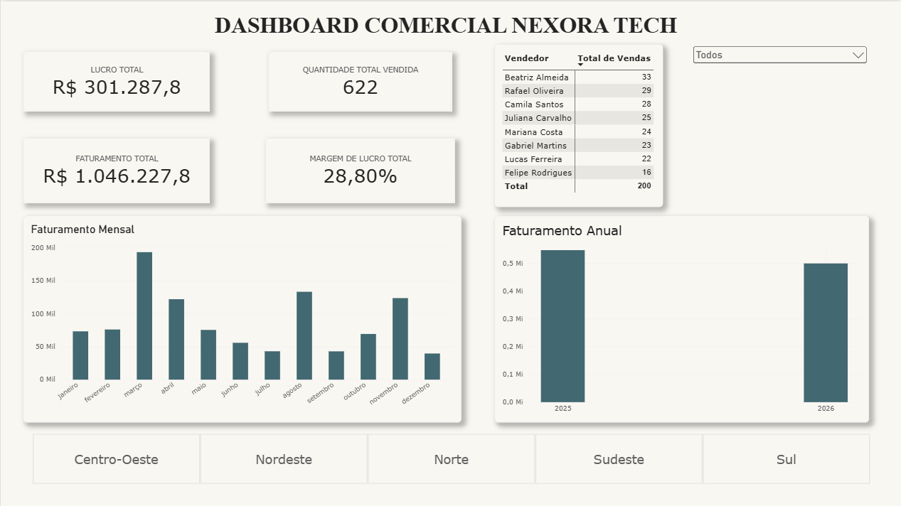

Projeto 01 – Dashboard Comercial | Nexora Tech

Sobre o projeto:
Projeto de análise de dados comerciais desenvolvido com Power BI, Excel e DAX, utilizando uma empresa fictícia do setor de tecnologia.

Objetivo:
Desenvolver um dashboard interativo para analisar o desempenho comercial da empresa, acompanhando indicadores de faturamento, custos, lucro e vendas.

Ferramentas utilizadas:
- Microsoft Excel
- Power BI
- DAX
- Power Query

Resultados e análises
O dashboard permite acompanhar o desempenho comercial da Nexora Tech por meio de indicadores de faturamento, lucro, margem de lucro e quantidade de vendas.

Indicadores (KPIs):
- Faturamento total: R$ 1.046.227,80.
- Lucro total:  R$ 301.287,80.
- Margem de lucro: 28,80%
- Quantidade de vendas: 622

Análises desenvolvidas:
- Faturamento por período
- Comparação do faturamento anual.
- Desempenho por vendedor
- Distribuição das vendas por região.
- Acompanhamento dos indicadores de faturamento, lucro, margem de lucro e quantidade vendida.

Aprendizados:
Durante o desenvolvimento deste projeto, foram praticados conceitos de:
- Tratamento e organização de dados.
- Relacionamento entre tabelas.
- Criação de medidas utilizando DAX.
- Desenvolvimento de indicadores de desempenho (KPIs).
- Construção de dashboards interativos.
- Análise e interpretação de dados comerciais.

Status do projeto:
Em desenvolvimento
