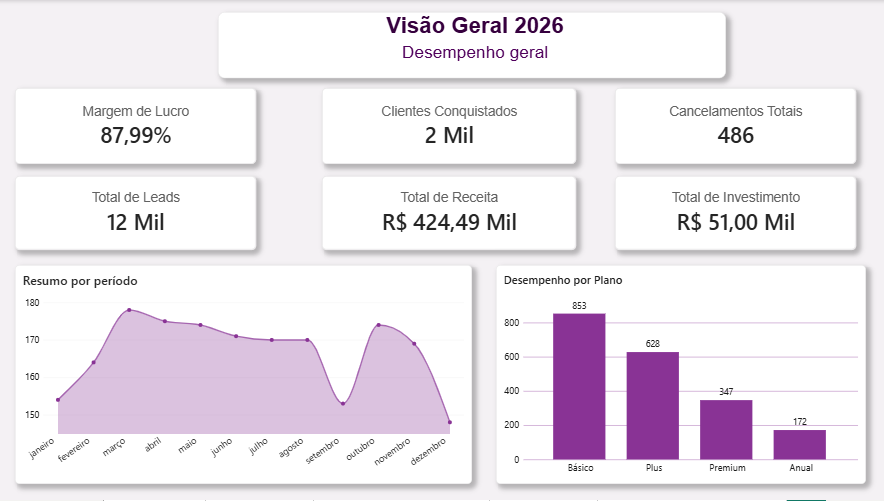
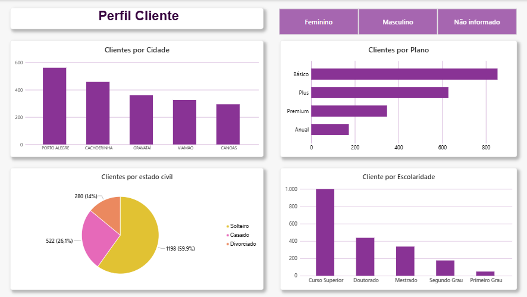
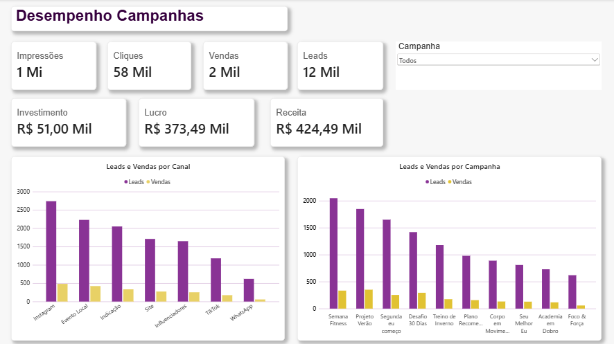
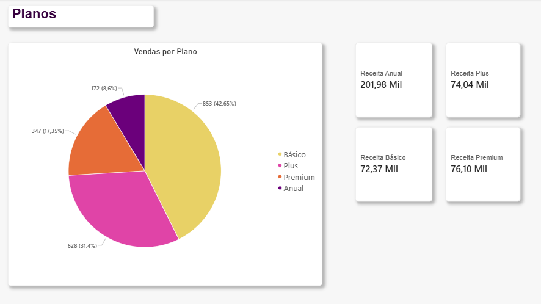
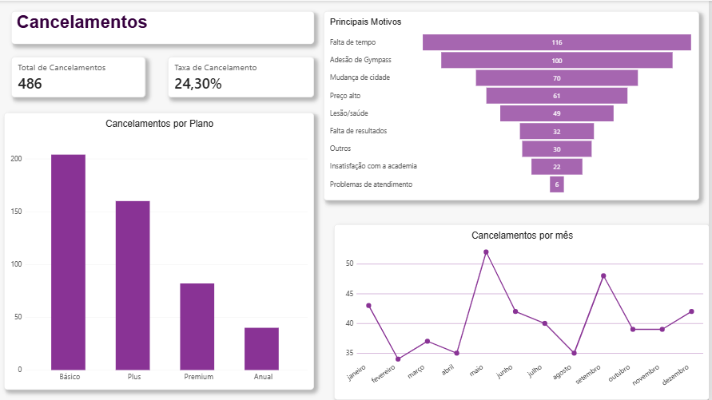

Dashboard de Marketing Digital — MoviFit

Projeto de Business Intelligence desenvolvido no Power BI para análise de campanhas de marketing, clientes, planos, receita e cancelamentos de uma academia fictícia.

Objetivo: 
O objetivo do projeto é transformar dados de clientes, campanhas, planos e cancelamentos em informações que auxiliem na análise do desempenho de marketing e na tomada de decisões.

Análises realizadas:

Visão Geral
- Clientes conquistados
- Cancelamentos
- Taxa de cancelamento
- Leads gerados
- Receita
- Margem de lucro
- Campanha com maior receita
 
Perfil dos Clientes
- Clientes por cidade
- Sexo
- Escolaridade
- Estado civil
- Objetivo
- Plano escolhido

Desempenho das Campanhas
- Impressões
- Cliques
- Leads
- Vendas
- Investimento
- Receita
- Desempenho por canal
- Conversão de leads em vendas

Análise de Planos
- Planos mais vendidos
- Distribuição das vendas por plano
- Receita por plano

Cancelamentos
- Total de cancelamentos
- Taxa de cancelamento
- Principais motivos
- Cancelamentos por plano
- Cancelamentos ao longo dos meses

Ferramentas utilizadas
- Power BI
- DAX
- Power Query
- Excel
- Modelagem de dados

Dashboard

Visão Geral

Perfil do Cliente

Desempenho das Campanhas

Planos

Cancelamentos

